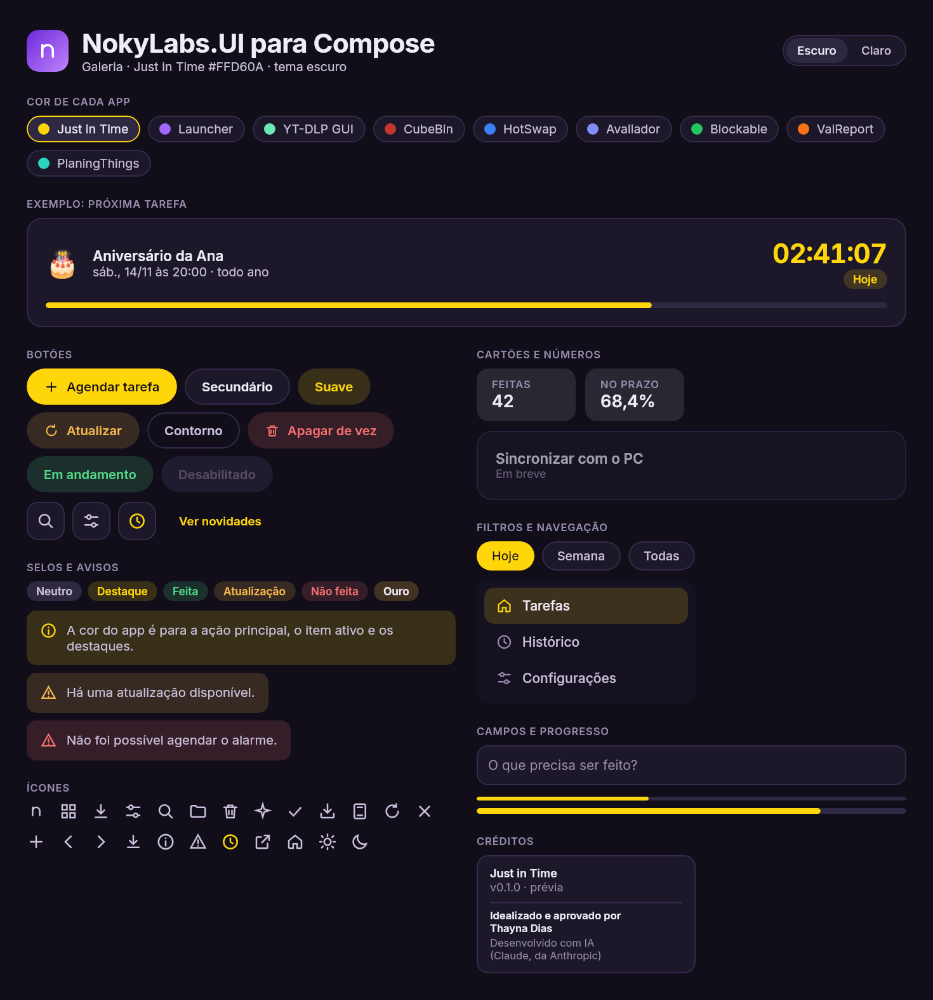
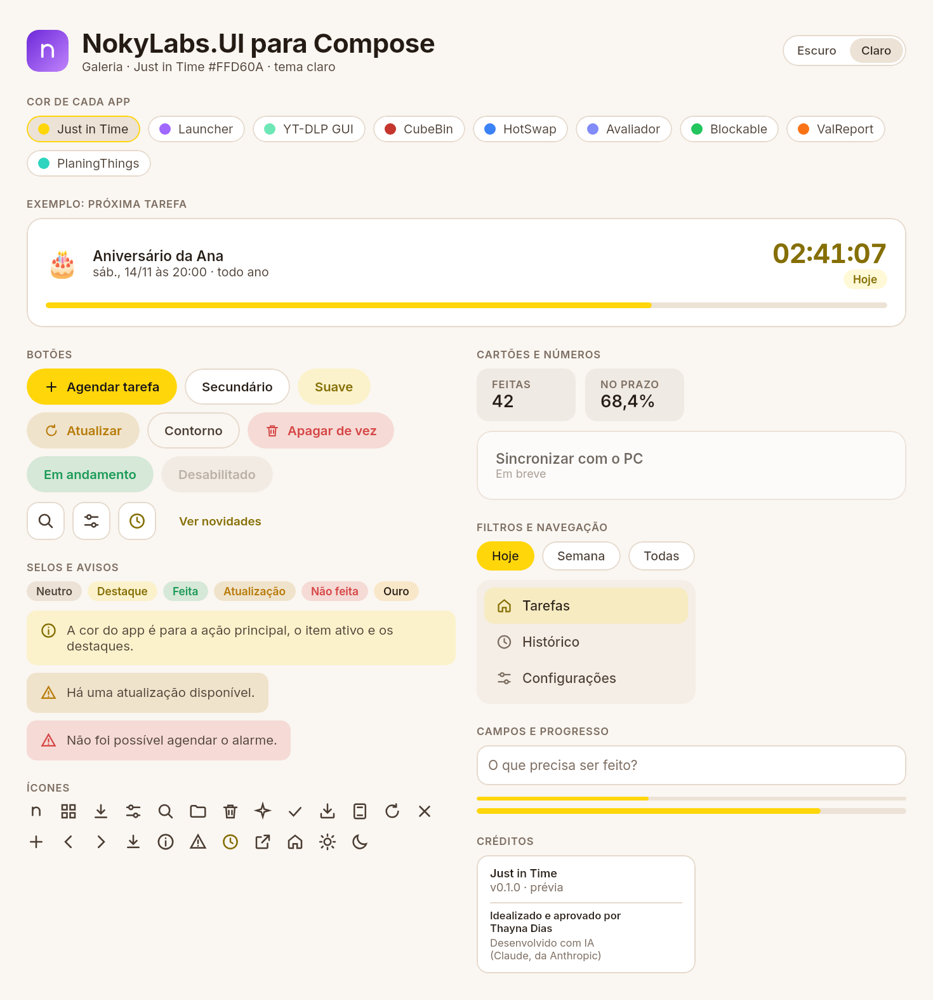

# NokyLabs.UI para Compose (Android)

O **Kit NokyLabs** traduzido para **Jetpack Compose / Compose Multiplatform**: as mesmas cores, cantos, botões, cartões, ícones, animações e créditos do kit em Avalonia, para os apps Android da NokyLabs (o primeiro é o **Just in Time**). Funciona no Android e também em apps de PC feitos em Compose.

Como no kit em Avalonia, **cada app só escolhe a sua cor de destaque**. O resto (hover, pressionado, fundo translúcido, cor de texto e a cor do texto por cima do botão) é calculado pelo `AccentPalette`, com **as mesmas contas** do `AccentPalette.cs`. Os testes conferem que os resultados são idênticos.

| Escuro | Claro |
|---|---|
|  |  |

## Como usar num app

1. **Traga a biblioteca** (uma vez), igual ao kit em Avalonia:
   ```powershell
   git submodule add https://github.com/ThayTTG/NokyLabs.UI.git lib/NokyLabs.UI
   ```
   No `settings.gradle.kts` do app:
   ```kotlin
   include(":nokylabs-ui")
   project(":nokylabs-ui").projectDir = file("lib/NokyLabs.UI/compose/nokylabs-ui")
   ```
   E no `build.gradle.kts` do módulo do app:
   ```kotlin
   dependencies { implementation(project(":nokylabs-ui")) }
   ```
2. **Envolva as telas no tema**, com a cor do app:
   ```kotlin
   NokyTheme(accent = NokyColors.JustInTime) {
       // telas do app
   }
   ```
   O tema segue o escuro/claro do sistema; para forçar, use `NokyTheme(accent, dark = true)`.
3. **Créditos**: na tela "Sobre" (ou no rodapé da barra lateral, no PC):
   ```kotlin
   NokyCreditsCard(appName = "Just in Time", version = "v0.1.0")
   ```

Para atualizar a biblioteca dentro de um app: `git submodule update --remote lib/NokyLabs.UI`.

## O que vem pronto

| No Avalonia | No Compose |
|---|---|
| `<ui:NokyTheme Accent="…">` | `NokyTheme(accent = …) { }` |
| `TextBlock.h1/h2/h3/secondary/muted/caps` | `NokyTheme.type.h1`, `.h2`, `.h3`, `.secondary`, `.muted`, `.caps` |
| `TextBlock.num` | `estilo.merge(NokyTheme.type.num)` |
| `DynamicResource SurfaceBrush`, `AccentBrush`… | `NokyTheme.colors.surface`, `.accent`, `.accentText`, `.onAccent`… |
| `Button.primary/secondary/soft/warn/ghost/danger/running` | `NokyButton(texto, onClick, kind = NokyButtonKind.Primary…)` |
| `Button.icon` (com `ToolTip.Tip`) | `NokyIconButton(ícone, contentDescription, onClick)` |
| `Button.link` | `NokyLinkButton(texto, onClick)` |
| `Border.card` (+ `clickable`, `soon`) | `NokyCard(onClick = …, soon = …) { }` |
| `Border.stat` | `NokyStat { }` |
| `Border.badge` + tipo | `NokyBadge(texto, NokyBadgeKind.Success…)` |
| `Border.notice` + tipo | `NokyNotice(texto, NokyNoticeKind.Warning…)` |
| `RadioButton.chip` | `NokyChip(texto, selecionado, onClick)` |
| `Border.segmented` + `RadioButton.seg` | `NokySegmented(opções, selecionado, onSelect)` |
| `RadioButton.nav` | `NokyNavItem(texto, selecionado, onClick, icon = …)` |
| `TextBox.field` | `NokyTextField(valor, onValueChange, placeholder = …)` |
| `ProgressBar` (+ `slim`) | `NokyProgressBar(progresso, slim = …)` (`null` = sem fim definido) |
| `{StaticResource IconSearch}` | `NokyIcons.Search` (com `NokyIcon(…)` ou o `Icon` do Material) |
| `ui:Anim.Entrance` + `Order` | `Modifier.nokyEntrance(order = 2)` |
| `ui:Anim.CountTo` + `Format` | `NokyCountText(alvo, format = "{0:N1}%")` |
| `Anim.Enabled = false` | `NokyAnim.enabled = false` |
| `CreditsCard` | `NokyCreditsCard(appName, version)` |
| — | `NokyBrandMark()` (o quadradinho com o "n"), `NokySectionLabel("…")` |

Os componentes do **Material 3** (Checkbox, Switch, Slider, seleção de texto…) também passam a usar a cor do app, como os controles do Fluent no kit em Avalonia. A fonte **Inter** vem dentro da biblioteca (licença em `nokylabs-ui/INTER-LICENSE.txt`).

## Diferenças do celular

- **Não existe "mouse por cima" no toque.** Os estados de hover funcionam no PC; no celular, o retorno é o botão encolhendo ao tocar e, nos cartões clicáveis, a borda na cor do app enquanto o dedo está em cima.
- O `Running` ("vira vermelho para Encerrar") depende do hover: no celular, use um botão `Danger` separado para encerrar.
- `NokyIconButton` pede `contentDescription` (é o que o leitor de tela fala), no lugar do ToolTip.

## Regras do Kit (as mesmas)
- A cor do app é para **a ação principal, o item ativo e os destaques**. Estados continuam com as cores de sempre: verde = feito/sucesso, âmbar = atualização, vermelho = erro/apagar.
- Quando a cor do app é parecida com a de um estado, o estado ganha **ícone e texto claro**, nunca só a cor. O **amarelo do Just in Time** é vizinho do âmbar de "atualização": por isso avisos e selos de atualização sempre vão com o ícone (`NokyIcons.Refresh` / `NokyIcons.Alert`) e o texto.

## Galeria
```powershell
cd compose
./gradlew :galeria:run        # abre a Galeria numa janela (troca a cor do app e o tema)
./gradlew :galeria:capturar   # gera as imagens de capturas/ sem abrir janela
```

## Testes
```powershell
cd compose
./gradlew :nokylabs-ui:desktopTest
```
Os mesmos testes do kit em Avalonia (texto legível 4,5:1 nos dois temas, texto do botão com pelo menos 3:1, cores claras com texto escuro…), mais um teste que confere que as contas dão **exatamente** os mesmos valores do `AccentPalette.cs`.

## Versões usadas
Kotlin 2.0.21 · Compose Multiplatform 1.7.3 · Android Gradle Plugin 8.7.3 · Gradle 8.11.1 · Android 8.0+ (minSdk 26).

---
Idealizado e aprovado por Thayna Dias · Desenvolvido com IA (Claude, da Anthropic)
